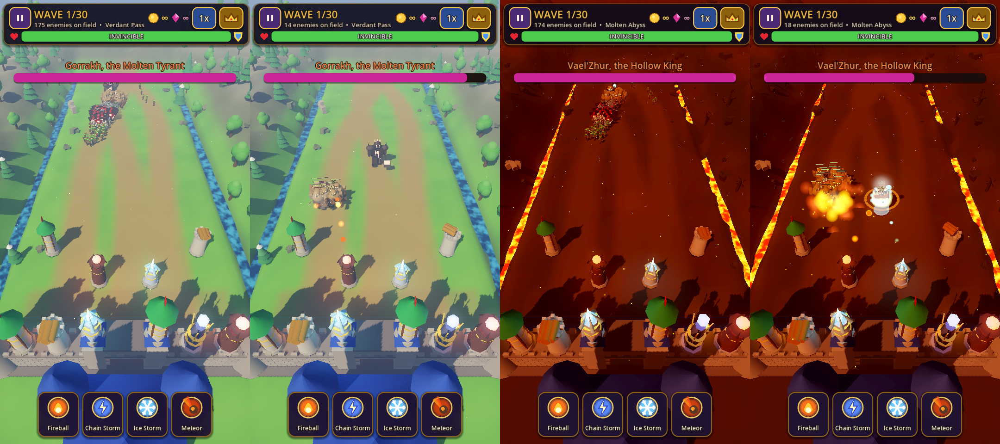
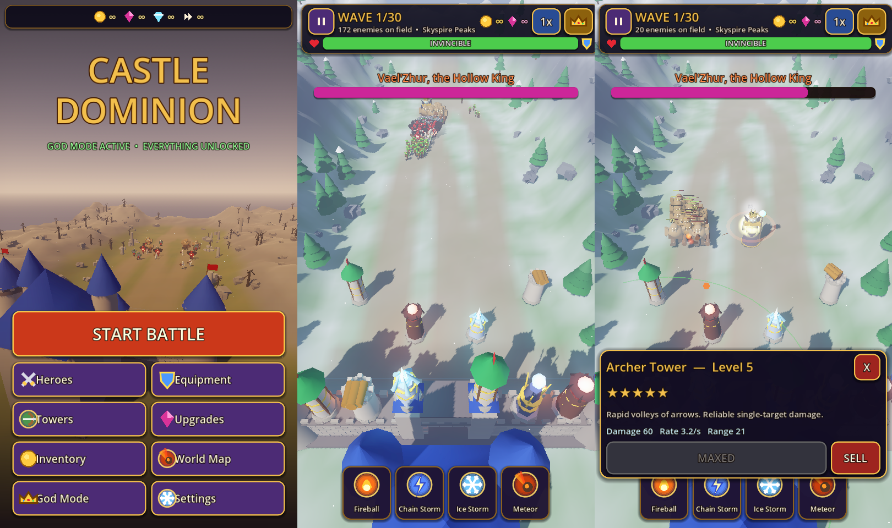

# Castle Dominion

An original 3D fantasy tower-defense game for **Godot 4.3+ (GDScript)**, designed for portrait iPhone play with
**permanent God Mode** enabled by default: no payments, ads, subscriptions or grinding.

All art is generated in code: procedural low-poly models, shaders, particles and vector UI icons.
The project ships no external or third-party art assets.




## Running

1. Install Godot 4.3 or newer (standard build, not .NET).
2. Open `project.godot` in the editor and press **Play**, or run `godot --path .` from this folder.
3. The desktop window opens at 540×960 (portrait). Mouse emulates touch.

**Controls:** tap a glowing pad to build, tap a tower to upgrade or sell, tap an enemy to focus fire (manual
targeting), tap a spell and then the battlefield to cast. Drag to pan, and use the mouse wheel or pinch to zoom.
The **crown** button opens the God Mode panel.

## Status (Phase 1 + early Phase 2)

| Area | State |
|---|---|
| 3D battlefield: procedural terrain, lanes, river/lava channels, trees, rocks, ruins, sky, fog, glow, shadows | Working |
| 4 maps: Verdant Pass, Molten Abyss, Shattered Ruins, Skyspire Peaks | Working |
| Castle: stone walls, gatehouse, corner towers, keep, banners, torches, magic barrier | Working |
| Horde: 5 enemy types + 2 bosses, GPU-animated limbs, one MultiMesh per type, health bars | Working; stress-tested with 500+ enemies |
| Enemy movement: 3 curving lanes with spread, wall attack, slow/freeze/burn | Working (lane-following, not grid pathfinding) |
| Towers: Archer, Cannon, Storm Spire, Inferno, Frost; 5 levels each with visual changes | Working |
| Spells: Fireball, Chain Storm, Ice Storm, Meteor | Working |
| Waves: Campaign (30), Endless, Boss Rush, Sandbox, God Mode Playground | Working |
| God Mode panel: invincibility, unlimited resources, no cooldowns, free upgrades, one-hit kills, instant waves, game/attack speed, spawn count, spawn armies/bosses, kill all, max/fill towers, change map/difficulty, reset, unlock/max all | Working, saved between sessions |
| Main menu: Start Battle (mode/map/difficulty), Towers, Inventory, World Map, God Mode, Settings | Working |
| Heroes, Equipment, Upgrades screens | Placeholder screens (Phase 3) |
| Traps, barriers, walls as buildable defenses | Not yet (Phase 3) |
| Sound and music | Not yet (Phase 4) |
| Roguelike picks, loot tables, permanent progression trees | Not yet (Phase 3/5) |
| iOS export preset and device testing | Not yet (Phase 6) |

### Known issues
- In the **Compatibility (OpenGL)** renderer the horde shader shows wrong colours (dark teal tint). The project
  targets the **Mobile (Vulkan/Metal)** renderer, where it renders correctly. Fix planned for Phase 6.
- Headless runs print `Parameter "m" is null` at shutdown. This comes from the dummy renderer only and is harmless.

## Tests

```bash
godot --headless --import
godot --headless res://tests/smoke_test.tscn   # gameplay + God Mode checks (exits 1 on failure)
godot --headless res://tests/modes_test.tscn   # loads menu + every mode on every map
tests/shoot.sh <out_dir> <map> <battle|menu>   # real-renderer screenshots (xvfb + lavapipe Vulkan)
```

## Layout

```
scripts/autoload/  game_data.gd (definitions), game_state.gd (God Mode, currencies, saves)
scripts/core/      mesh_kit.gd (mesh merging), models.gd (procedural model library)
scripts/battle/    battle, world_builder, castle, enemy_manager, tower, projectile_system,
                   spell_system, wave_manager, fx
scripts/ui/        ui_theme, icon_art, hud, god_panel, main_menu
shaders/           unit (horde animation), prop, liquid (lava/water), hpbar
scenes/            main_menu.tscn, battle.tscn
tests/             smoke_test, modes_test, screenshot
```
