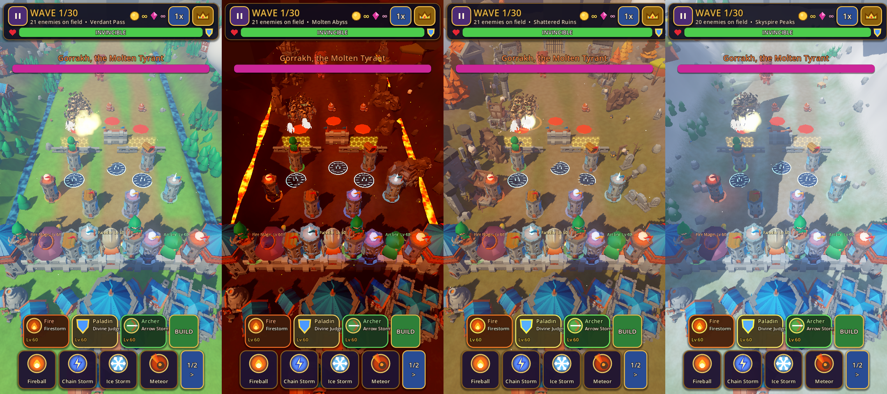
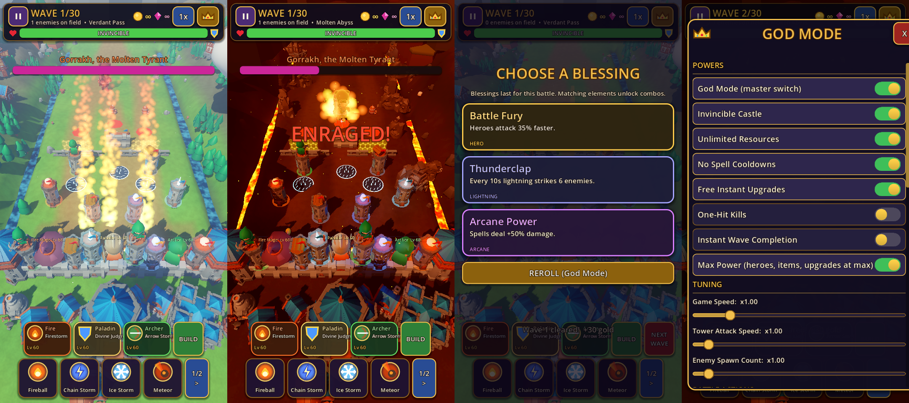
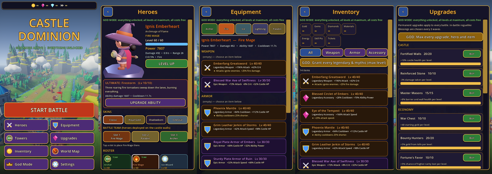

# Castle Dominion

An original 3D fantasy tower-defense game for **Godot 4.5+ (GDScript)**, designed for portrait iPhone play with
**permanent God Mode** enabled by default: no payments, ads, subscriptions or grinding.





## Running

1. Install **Godot 4.5.1** or newer (standard build, not .NET).
2. Open `project.godot` in the editor and press **Play**, or run `godot --path .`.
3. The desktop window opens at 540×960 (portrait). Mouse emulates touch.
4. On first launch the game bakes character animations (about 5 s, with a progress screen). They are then cached in `user://bake_cache/`.

**Controls:**
- Tap a glowing pad to build a tower; tap a tower to upgrade or sell it.
- **BUILD** places traps, barriers and walls on the battlefield.
- Tap a hero portrait to fire their ultimate. Tap a spell, then the battlefield, to cast (**1/2 >** pages through the 8 spells).
- Tap an enemy to focus all fire on it.
- Drag to pan; use the mouse wheel or pinch to zoom.
- The **crown** button opens the God Mode panel.

## Art

Characters and environment use **CC0 KayKit assets by Kay Lousberg** (rigged and animated characters, castle and
nature kits; see [CREDITS.md](CREDITS.md)). They are recoloured and re-equipped per hero or enemy. Effects, shaders,
the dragon, UI icons and all gameplay are original code. `tools/fetch_assets.sh` documents where every asset came from.

Horde rendering: rigged characters are baked by `UnitBaker` (CPU skinning) into walk, attack and death frame meshes,
plus automatically decimated LOD frames. Hundreds of animated units then draw as one MultiMesh per (type, frame).

## Feature status

### Done and covered by automated tests
| Area | Notes |
|---|---|
| **9 heroes** | Archer, Fire Mage, Ice Wizard, Lightning Sorcerer, Paladin, Druid, Necromancer, Dwarf Engineer, Dragon Summoner. Animated models; each has unique weapons, colours, attack type, element and ultimate. |
| **Hero ultimates** | Arrow Storm, Firestorm (fire tornadoes), Glacial Spikes, Thunder Dome, Divine Judgment (light pillar + castle heal), Wrath of the Grove (roots + poison), Army of the Dead (spectral allies), Mortar Barrage, Summon Elder Dragon (flying procedural dragon). |
| **Hero progression** | Levels 1–60 with XP from battles, ability levels 1–10, 4 skins, 3-hero team on the castle walls. |
| **Equipment** | Weapon, armor and accessory slots; 5 rarities (Common to Mythic); upgradeable item levels; 14 named legendaries/mythics with unique effects; salvage. |
| **Defenses** | Spike Trap, Blast Barrel, Frost Rune, Arcane Barrier (hex force field) and Stone Wall, each with 3 visual levels. Blockers hold enemies until destroyed. |
| **Roguelike** | 24 blessings offered every 3 waves (every wave in Playground), stacking modifiers, 7 combos (Steam Burst, Superconductor, Wildfire, Shatter…). |
| **Loot** | Coins fly to the castle; bosses and elites drop treasure chests with equipment; rewards and hero XP are kept after each battle. |
| **Permanent upgrades** | 13 upgrades across Castle, Economy, Towers, Magic and Heroes. |
| **Enemies** | 9 regular types (goblins, 4 skeleton kinds incl. ranged archers and mages, orcs, fiends, ogres, dread knights) and 4 elite affixes. |
| **Bosses** | Molten Tyrant (slam), Hollow King (summon + soul shield), Bone Colossus (slam), Dread Warlord (rally). Cinematic intro (camera fly-in, letterbox, title, slow motion) and enrage at 50% HP. |
| **Spells** | Fireball, Chain Storm, Ice Storm, Meteor, Meteor Rain, Firestorm, Frost Nova, Divine Wrath. |
| **Menus** | Heroes (live 3D turntable), Equipment, Inventory, Upgrades, Towers, World Map, Settings, God Mode. No placeholder screens remain. |
| **God Mode** | Unlimited resources, everything unlocked, Max Power (heroes, abilities, items, upgrades at max), no cooldowns, invincible castle and defenses, one-hit kills, instant waves, game/attack speed, spawn count, per-boss spawning, build all defenses, blessing tools, grant all legendaries. |
| **Phase 1 features** | 4 maps, 5 modes, 5 towers with 5 levels, wave system, save data: all kept. |

### Not done yet
- Sound and music (Phase 4).
- Hand-authored VFX textures and post-processing polish (Phase 4); current effects are procedural.
- An iOS export preset and testing on a real device (Phase 6). Performance has only been measured on desktop/software rendering.
- The Compatibility (OpenGL) renderer tints the horde shader incorrectly; the target Mobile (Vulkan/Metal) renderer is correct.

## Tests

```bash
godot --headless --import
godot --headless res://tests/compile_check.tscn   # compiles every script
godot --headless res://tests/smoke_test.tscn      # core gameplay + God Mode
godot --headless res://tests/phase3_test.tscn     # heroes, defenses, blessings, loot, bosses, equipment, saves (52 checks)
godot --headless res://tests/modes_test.tscn      # menu + every mode on every map
tests/shoot.sh <out_dir> <map> <battle|menu|heroes>   # real-renderer screenshots (xvfb + lavapipe Vulkan)
```

## Layout

```
assets/kaykit/      CC0 KayKit models (characters, hexagon, dungeon, halloween) + licences
scripts/autoload/   game_data.gd (all content definitions), game_state.gd (progression, God Mode, saves)
scripts/core/       unit_baker (animation baking), assets, models (procedural), loot, hero_stats, mesh_kit
scripts/battle/     battle, world_builder, castle, enemy_manager, tower, hero, hero_abilities, defenses,
                    run_state, loot_drops, boss_director, spell_system, projectile_system, wave_manager, fx
scripts/ui/         hud, god_panel, main_menu, hero_preview, ui_theme, icon_art
shaders/            unit_tex (horde), prop_tex, terrain, force_field, liquid, bar, hpbar, prop, unit
tools/              fetch_assets.sh
tests/              compile_check, smoke_test, phase3_test, modes_test, screenshot, closeup, hero_lineup
```
