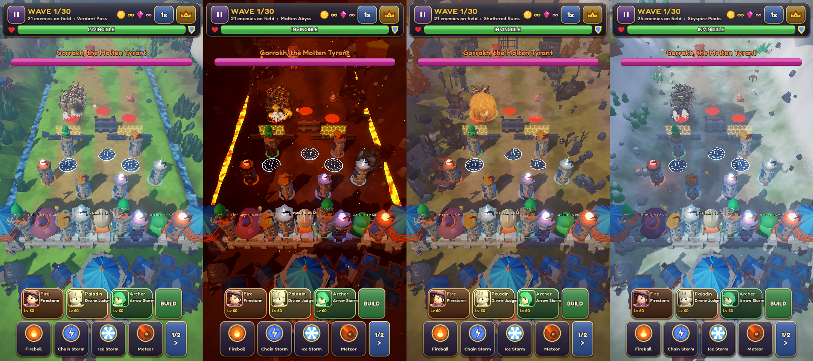
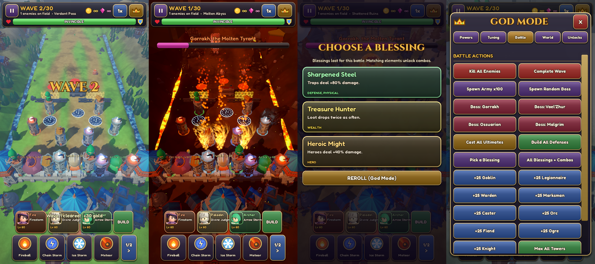
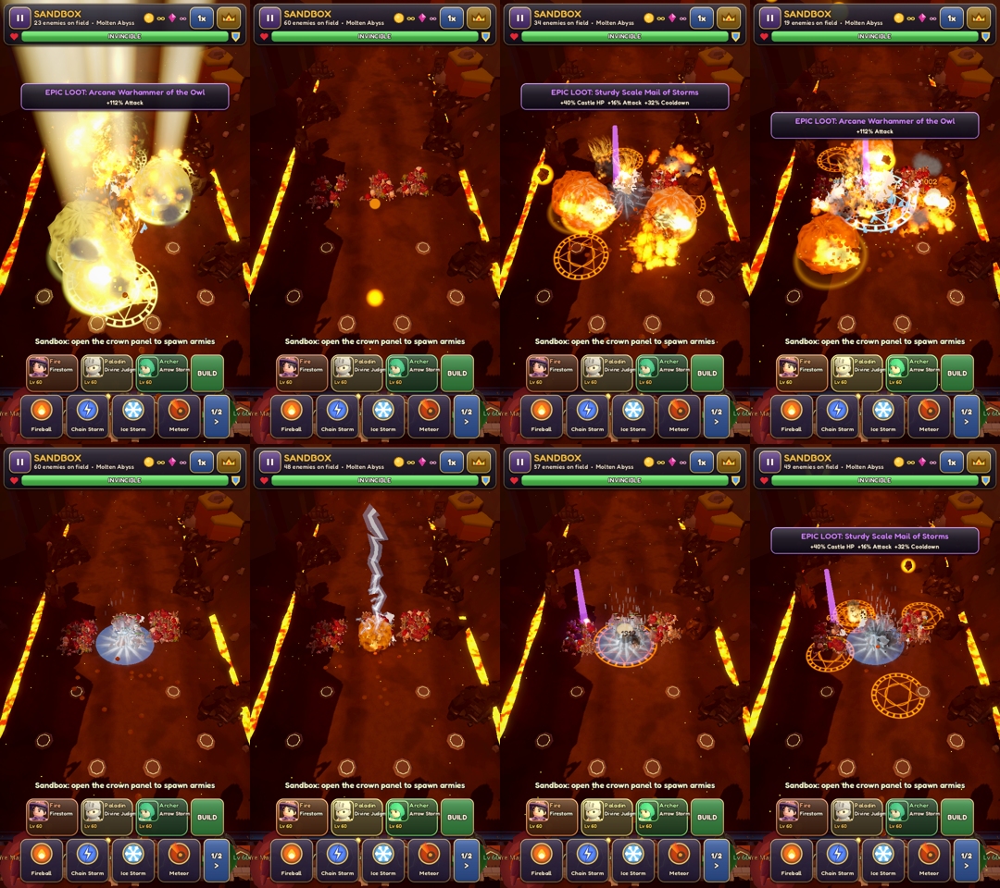
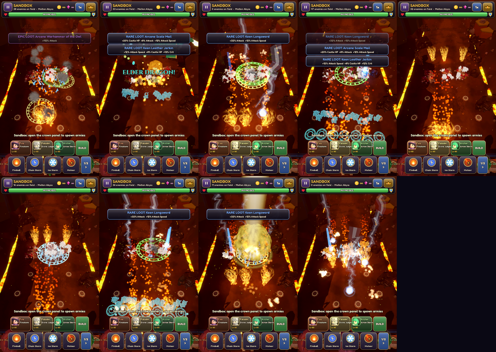
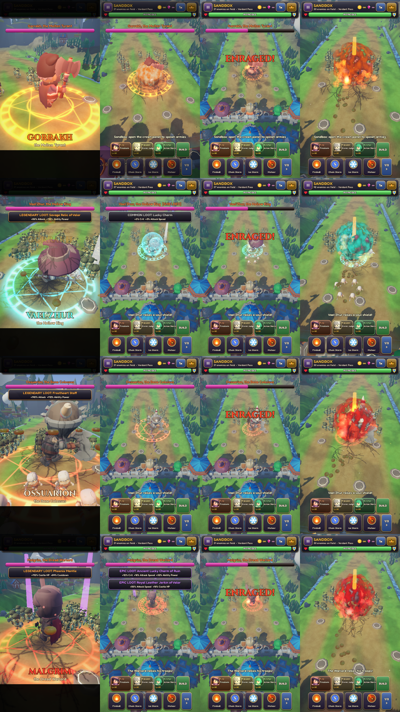
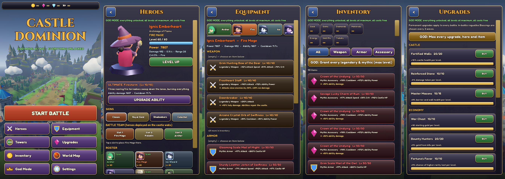
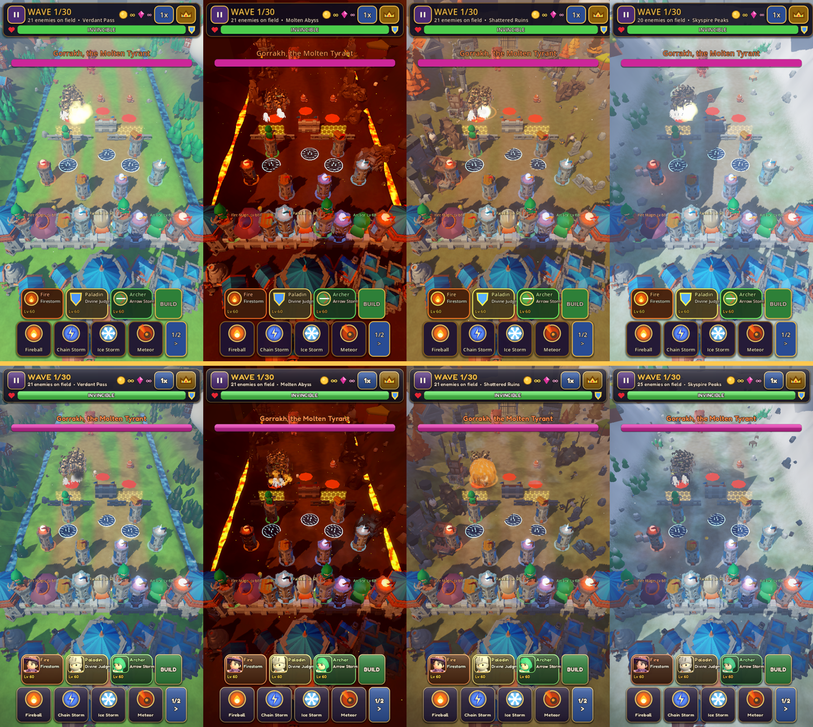
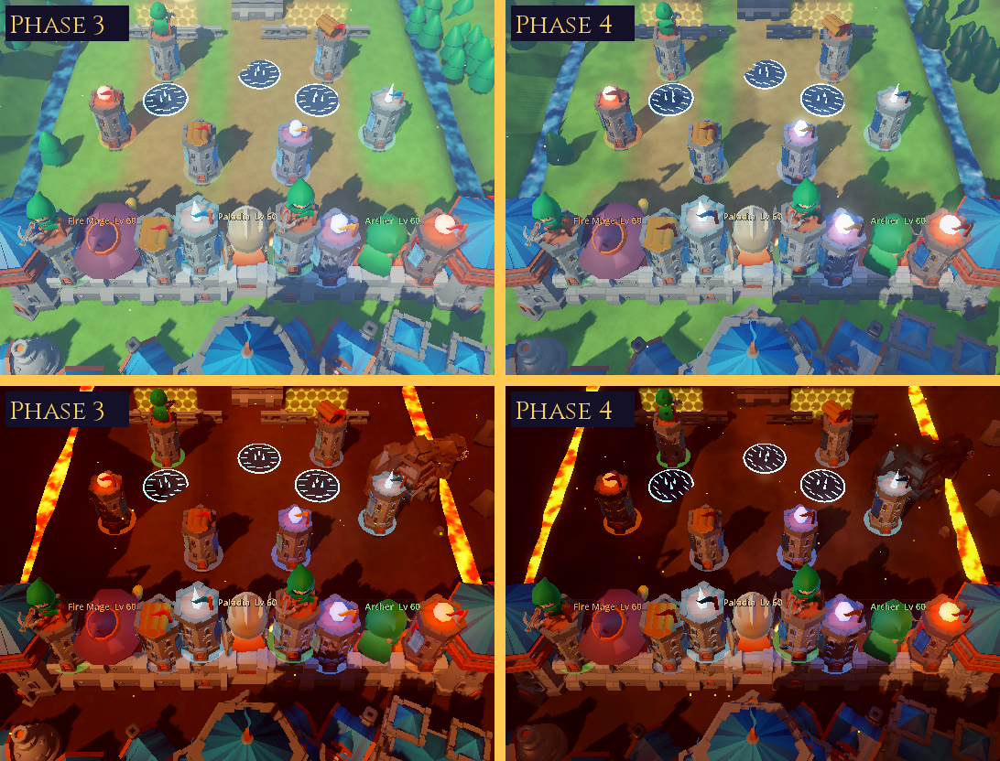

# Castle Dominion

An original 3D fantasy tower-defense game for **Godot 4.5+ (GDScript)**, designed for portrait iPhone play with
**permanent God Mode** enabled by default: no payments, ads, subscriptions or grinding.








Before (Phase 3, top) and after (Phase 4, bottom), same scene and camera:




## Running

1. Install **Godot 4.5.1** or newer (standard build, not .NET).
2. Open `project.godot` in the editor and press **Play**, or run `godot --path .`.
3. The desktop window opens at 540×960 (portrait). Mouse emulates touch.
4. On first launch the game bakes character animations (about 5 s, with a progress screen). They are then cached in `user://bake_cache/`.

**Controls:**
- Tap a glowing pad to build a tower; tap a tower to upgrade or sell it.
- **BUILD** places traps, barriers and walls on the battlefield.
- Tap a hero portrait to fire their ultimate. Tap a spell, then the battlefield, to cast (**1/2 >** pages through the 8 spells).
- Tap an enemy to focus all fire on it.
- Drag to pan; use the mouse wheel or pinch to zoom.
- The **crown** button opens the God Mode panel.

## Art

Characters and environment use **CC0 KayKit assets by Kay Lousberg** (rigged and animated characters, castle and
nature kits; see [CREDITS.md](CREDITS.md)). They are recoloured and re-equipped per hero or enemy. Effects, shaders,
the dragon, UI icons and all gameplay are original code. `tools/fetch_assets.sh` documents where every asset came from.

Horde rendering: rigged characters are baked by `UnitBaker` (CPU skinning) into walk, attack and death frame meshes,
plus automatically decimated LOD frames. Hundreds of animated units then draw as one MultiMesh per (type, frame).

## Phase 4: graphics, audio and animation

| Area | What changed |
|---|---|
| **Castle and terrain** | World-space masonry shader (staggered bricks, mortar, per-stone colour variation, ground grime) on castle walls and towers; retuned key, fill and rim lighting; height fog; drifting cloud shadows; animated water and lava with fresnel and glints; weather particles per map (Medium and High only). |
| **Spells (8)** | Fireball (fire core, smoke, scorch decal), Chain Storm (branching lightning arcs), Ice Storm (falling shards, frost decal), Meteor and Meteor Rain (rune warning circle, fiery trail, shockwave, ground cracks), Firestorm, Frost Nova (ice burst ring), Divine Wrath (light pillars). |
| **Ultimates (9)** | Arrow Storm, Firestorm (shader-driven fire tornadoes), Glacial Spikes, Thunder Dome (energy dome shader), Divine Judgment, Wrath of the Grove, Army of the Dead, Mortar Barrage, Elder Dragon (flying dragon with fire-breath jet). |
| **Bosses** | Each of the 4 bosses has its own colours, aura light and particles, camera framing and title colour. Cinematic intro with letterbox bars, name and epithet card, and slow motion. Signature attacks: molten rain slam, bone spikes, skeleton summon with soul shield, war-cry rally. At 50% HP they enrage: they grow, glow, speed up and attack faster. The death sequence plays chained explosions, a light pillar and slow motion, then a "Boss Defeated" reward banner. |
| **Animation** | Units have baked walk, attack, hit-react, death and special frames. Heroes have idle, attack and cast animations and a victory celebration. Damage flashes, freeze tint and knockback on hits. |
| **Audio** | 5 original music tracks (menu, battle, boss, victory, defeat) with crossfades, plus 43 original sound effects: swords, arrows, cannons, lightning, fire, ice, holy, nature, shadow, enemies, bosses, UI, loot and level-up. Separate Music and SFX volume sliders, a 20-voice pool and per-sound cooldowns so big fights never flood the mixer. Everything is synthesized by `tools/synth_audio.py` (numpy), so no third-party audio is used. |
| **UI** | OFL fonts (Cinzel for titles, Fredoka for body text). Generated 9-slice panels with gradient, gloss, bevel and shadow. Hero portraits rendered from the actual 3D models. Screen vignette, tabbed God Mode dashboard, quality and FPS settings. |
| **Performance** | Graphics presets (Low, Medium, High) for render scale, MSAA, shadows, particle budget, LOD distance and weather. Static props merged per material (`StaticBatcher`). Hordes drawn as one MultiMesh per animation frame, with decimated LOD frames and a cap on high-detail units. Blob shadows replace real shadows for units. Enemy queries use a spatial grid. Particles have a global budget. On-screen FPS overlay. |

### Performance measurements

Measured with `tests/benchmark.tscn` on Verdant Pass with all towers and defenses built, using the Mobile renderer
at 540×960 on **lavapipe (a CPU software Vulkan rasterizer)**. Frame times from lavapipe say nothing about iPhone
GPU speed. Draw calls, triangle counts and horde simulation cost are the useful numbers.

| Quality | Enemies | Frame ms | Sim ms | Render-prep ms | Draw calls | Triangles | VRAM MB |
|---|---|---|---|---|---|---|---|
| Low | 99 | 343.5 | 1.64 | 1.73 | 415 | 522k | 302 |
| Low | 295 | 389.2 | 4.82 | 3.13 | 437 | 956k | 307 |
| Low | 590 | 437.6 | 8.26 | 5.83 | 470 | 1626k | 307 |
| Medium | 98 | 789.4 | 2.03 | 1.95 | 620 | 807k | 323 |
| Medium | 295 | 488.5 | 5.12 | 3.30 | 644 | 1291k | 323 |
| Medium | 594 | 566.5 | 8.80 | 5.80 | 660 | 2050k | 323 |
| High | 98 | 792.6 | 2.50 | 1.99 | 627 | 1026k | 330 |
| High | 297 | 516.0 | 4.12 | 3.44 | 648 | 1543k | 330 |
| High | 592 | 637.4 | 7.76 | 5.14 | 683 | 2357k | 335 |

Before batching and blob shadows, the same High scene needed 883–964 draw calls. Most of the Low→Medium jump
(about 200 draws) comes from the shadow pass. The rest comes from per-frame horde buckets, towers, FX meshes and
hero parts.

These numbers have **not** been measured on an iPhone. The first real-device pass should target Medium, since the
draw-call count (415–683) is still above the roughly 300 that is comfortable on older iPhones.

## Feature status

### Done and covered by automated tests
| Area | Notes |
|---|---|
| **9 heroes** | Archer, Fire Mage, Ice Wizard, Lightning Sorcerer, Paladin, Druid, Necromancer, Dwarf Engineer, Dragon Summoner. Animated models; each has unique weapons, colours, attack type, element and ultimate. |
| **Hero ultimates** | Arrow Storm, Firestorm (fire tornadoes), Glacial Spikes, Thunder Dome, Divine Judgment (light pillar + castle heal), Wrath of the Grove (roots + poison), Army of the Dead (spectral allies), Mortar Barrage, Summon Elder Dragon (flying procedural dragon). |
| **Hero progression** | Levels 1–60 with XP from battles, ability levels 1–10, 4 skins, 3-hero team on the castle walls. |
| **Equipment** | Weapon, armor and accessory slots; 5 rarities (Common to Mythic); upgradeable item levels; 14 named legendaries/mythics with unique effects; salvage. |
| **Defenses** | Spike Trap, Blast Barrel, Frost Rune, Arcane Barrier (hex force field) and Stone Wall, each with 3 visual levels. Blockers hold enemies until destroyed. |
| **Roguelike** | 24 blessings offered every 3 waves (every wave in Playground), stacking modifiers, 7 combos (Steam Burst, Superconductor, Wildfire, Shatter…). |
| **Loot** | Coins fly to the castle; bosses and elites drop treasure chests with equipment; rewards and hero XP are kept after each battle. |
| **Permanent upgrades** | 13 upgrades across Castle, Economy, Towers, Magic and Heroes. |
| **Enemies** | 9 regular types (goblins, 4 skeleton kinds incl. ranged archers and mages, orcs, fiends, ogres, dread knights) and 4 elite affixes. |
| **Bosses** | Molten Tyrant (slam), Hollow King (summon + soul shield), Bone Colossus (slam), Dread Warlord (rally). Cinematic intro (camera fly-in, letterbox, title, slow motion) and enrage at 50% HP. |
| **Spells** | Fireball, Chain Storm, Ice Storm, Meteor, Meteor Rain, Firestorm, Frost Nova, Divine Wrath. |
| **Menus** | Heroes (live 3D turntable), Equipment, Inventory, Upgrades, Towers, World Map, Settings, God Mode. No placeholder screens remain. |
| **God Mode** | Unlimited resources, everything unlocked, Max Power (heroes, abilities, items, upgrades at max), no cooldowns, invincible castle and defenses, one-hit kills, instant waves, game/attack speed, spawn count, per-boss spawning, build all defenses, blessing tools, grant all legendaries. |
| **Phase 1 features** | 4 maps, 5 modes, 5 towers with 5 levels, wave system, save data: all kept. |

### Not done yet
- **iPhone not verified.** There is no iOS export preset yet and nothing has been tested on a real device. All rendering was tested on a CPU software rasterizer.
- Draw calls (about 415–683 depending on preset and horde size) are still higher than ideal for older iPhones. Next steps: fewer environment shadow casters on Medium, merging hero parts, quantizing attack frames to cut MultiMesh buckets.
- Automated tests share the game's save file, so running them adds test items (for example, duplicate legendaries) to the local inventory.
- The music and SFX are procedurally synthesized. They fit the game but are not studio-produced orchestral recordings.
- Characters use baked animation frames: the hordes run at about 10–15 animation fps by design, and heroes have no blended transitions between clips.
- The Compatibility (OpenGL) renderer tints the horde shader incorrectly. The target Mobile (Vulkan/Metal) renderer is correct.

## Tests

```bash
godot --headless --import
godot --headless res://tests/compile_check.tscn   # compiles every script
godot --headless res://tests/smoke_test.tscn      # core gameplay + God Mode
godot --headless res://tests/phase3_test.tscn     # heroes, defenses, blessings, loot, bosses, equipment, saves (52 checks)
godot --headless res://tests/modes_test.tscn      # menu + every mode on every map
godot --headless res://tests/phase4_test.tscn     # audio files/buses/volumes, quality presets, batching, grid, boss sequence
tests/shoot.sh <out_dir> <map> <battle|menu|heroes>   # real-renderer screenshots (xvfb + lavapipe Vulkan)
# fx_showcase / boss_showcase / benchmark: run with xvfb + lavapipe like shoot.sh, passing an output path after --
```

## Layout

```
assets/kaykit/      CC0 KayKit models (characters, hexagon, dungeon, halloween) + licences
scripts/autoload/   game_data.gd (content), game_state.gd (progression, God Mode, settings, saves), audio.gd
scripts/core/       unit_baker (animation baking), assets, static_batcher, fx_textures, models, loot, hero_stats, mesh_kit
scripts/battle/     battle, world_builder, castle, enemy_manager, tower, hero, hero_abilities, defenses,
                    run_state, loot_drops, boss_director, spell_system, projectile_system, wave_manager, fx
scripts/ui/         hud, god_panel, main_menu, hero_preview, hero_portraits, ui_theme, icon_art
shaders/            unit_tex (horde), prop_tex (masonry), terrain, liquid, explosion, shield, tornado, force_field, bar, hpbar, prop, unit
assets/audio/       original music + SFX (generated by tools/synth_audio.py)
assets/fonts/       Cinzel + Fredoka (SIL OFL)
tools/              fetch_assets.sh, synth_audio.py
tests/              compile_check, smoke_test, phase3_test, phase4_test, modes_test, benchmark, screenshot,
                    fx_showcase, boss_showcase, closeup, hero_lineup
```
